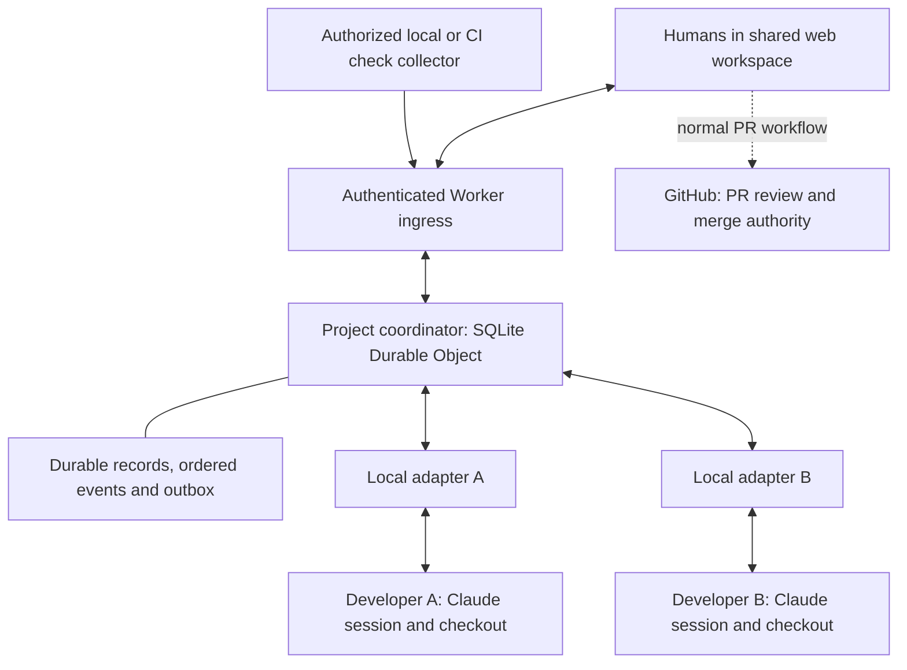

# Multiplayer coding-agent platform — architecture blueprint

Version 0.1 — 11 November 2026. Canonical entry point for the current design. Textual planning only; no application implementation, deployment or runtime validation is claimed.

## Subscription-based production constraint

The user has clarified the deployment goal: a published production application, with the hackathon as its first build milestone. Team members have Claude Pro and ChatGPT Plus access for Claude Code and Codex. Separately billed model APIs are outside the budget. This supersedes earlier statements treating their existing model-access arrangement as unknown.

Design the service as a coordination platform connected to user-controlled agent clients. Each user signs into the official client with their own account; provider subscription credentials stay outside the platform's shared service. No shared account, pooled subscription quota, credential extraction or required server-side model call is part of the design. Reasoning, summaries and technical proposals use a participating agent where available; routing, access checks, revision checks and state transitions are deterministic. If no agent is available, retain pending work rather than inventing an always-on AI coordinator.

Claude Code exposes MCP tools for connecting external systems. Its documented credential restrictions prohibit third-party Claude login and routing requests through consumer credentials on users' behalf. A user-installed MCP/hook integration with their own running client is the chosen integration direction; this does not establish blanket approval for an embedded/hosted runtime or SDK substitution. Review any future packaging against the current provider conditions.

Codex documents subscription authentication and an app-server integration surface. Its adapter should use supported client-managed authentication rather than treating a subscription as a generic API key. Both adapters require actual capability tests; their controls need not be identical.

Represent subscription limits, unavailable clients and expired sign-in as explicit waiting/blocker states. Pause work and resume after user action or quota recovery; never fall back to separately billed APIs automatically. Record reports only at useful milestones and bound agent exchanges because collaboration consumes the user's existing allowance.

Sources checked 11 November 2026: [Claude Code credential and product conditions](https://code.claude.com/docs/en/legal-and-compliance), [Claude Code MCP](https://code.claude.com/docs/en/mcp), [Codex authentication](https://learn.chatgpt.com/docs/auth), [Codex app-server](https://learn.chatgpt.com/docs/app-server). Infrastructure operation still has separate capacity/cost constraints; subscription-based inference does not establish free production hosting at arbitrary scale.

## 1. Product and problem

Teams use coding agents in separate sessions, while humans carry context, decisions, dependencies and feedback between them. The proposed platform makes their work collaborative: humans and independently owned agents plan connected work, ask questions, exchange outputs, adapt to shared decisions and verify a common outcome.

The user's six-person team uses Claude and Codex, assigns issues, implements through PRs and performs peer review. They reported more than 50 pending PRs, interdependencies, rebase/conflict and integration problems, and fragmented WhatsApp coordination. All three difficulties—conflicting code, incompatible intended behavior and diagnosing combined failures—matter. These motivate the broader platform; conflict repair does not define its full scope.

Target users initially are small software teams using several coding-agent sessions on related work. The benefit hypothesis is less manual context transfer and more reliable coordination. Savings, adoption and differentiation remain unmeasured.

## 2. User experience

Start a shared feature, establish responsibilities, connect participating agents, and let them work within the agreed plan. A teammate can inspect relevant work, ask questions, propose changes or help settle a dependency. Agents can exchange useful inputs without a human relaying every message.

Three initial surfaces:

- Project overview: active shared work, known dependencies and attention items.
- Feature/task room: accepted outcome, participating work packages/runs, plans, questions, decisions, handoffs and evidence.
- Connection/setup panel: pairing, authorized scope, checkout/run identity and supported adapter capability.

The room must answer what we are delivering, who owns each part, what each agent needs, which changes have actually been adopted, and what has been checked. Routine reporting is concise; full transcript capture is unnecessary for this scope.

## 3. System structure

Integration review refinement: AGENT_CAPABILITY_MATRIX.md records the official-documentation findings and real-client proof plan. Claude's baseline is attached-session MCP plus checkpoint hooks; custom push channels remain conditional preview support. Codex managed app-server sessions are a distinct mode from MCP exchange in existing sessions. No adapter is assumed to take over arbitrary live desktop/CLI conversations. Register tested capabilities per connection and gate controls accordingly. Managed automatic turn dispatch requires explicit per-human policy with bounded scope and stop conditions, separate from accepting task requirements.

Logical arrows describe required communication, not completed integrations. Agent execution and repository access stay on developers' machines for the first build. Evidence may be explicitly submitted; automatic GitHub/CI ingestion is optional later work, not a dependency of the initial collaboration loop.

| Component | Responsibility | Boundary |
| --- | --- | --- |
| React/TypeScript web client | Shared room, attention view, human decisions | Displays authoritative state; cannot establish authority by hiding controls. |
| Worker ingress | Authenticate, route, validate transport | Project coordinator rechecks current authorization. |
| Project coordinator | Agreements, ownership, routing, versions, atomic transitions and notification intent | One project consistency boundary; explicit capacity limits required. |
| Durable state/event log | Current records, history, replay and outbox | WebSocket delivery is not persistence. |
| Local Node adapter with MCP and supported hooks | Bind human/run/checkout, exchange bounded context, publish observations | Local tool permissions and external process lifecycle remain separate. |
| Evidence collector | Submit scoped observed checks | Preserve provenance; distinguish agent claims, human review and independently collected results. |

These are proposed technology choices. Free infrastructure allowances, compatibility and actual resource use must be verified before deployment. Model usage follows the subscription-based production constraint above.

## 4. Domain model and authority

- Project: membership, authority, shared contracts and rooms.
- Room: a shared outcome with participating work and discussion.
- Work package/task agreement: owned requirements, acceptance criteria and dependency pins. A joint-plan view references these records rather than copying authoritative scope.
- Run: one agent execution identity bound to a human, context generation and checkout.
- Shared contract: separately owned, versioned behavior used by related work.
- Question/change request/acknowledgement: explicit collaboration and decision records.
- Handoff: immutable artifact reference plus assumptions, producer and evidence.
- Evidence: scoped observation about identified artifacts and criteria.

Humans accept consequential scope, ownership or shared-contract changes under current authority. Agents propose, ask, answer, publish plans and hand off outputs within accepted scope. Feature coordination does not grant control over another human's task or terminal. Human ownership transfer and run replacement are separate operations.

GitHub remains authoritative for PR approval and merge state. Room decisions cannot bypass branch rules or local permissions. Initial status is advisory; automatic merging and merge blocking are outside this build.

## 5. Core collaboration protocol

1. Agree the outcome, ownership, criteria and shared dependencies.
2. Attach separate runs; provide relevant context and record explicit version acknowledgements.
3. Publish plans and exchange addressed questions. Routine answers need no new human approval.
4. Publish immutable handoffs; consumers declare the exact revision they use.
5. Route consequential changes to the appropriate human owner. Acceptance updates the shared target; each affected task explicitly reconciles its own agreement.
6. Record implementation reports and relevant individual/combined evidence separately.
7. Present remaining decisions, blockers, stale inputs and verification gaps for human action.

Do not collapse adapter receipt, supplied context, acknowledgement, reported adaptation and verification into one status. They answer different questions.

## 6. Reliability and security rules

- Check current access, complete actor/run/checkout bindings, expected versions and authority on every mutation.
- Persist mutation and notification intent atomically. Bound idempotency by the documented command window and recovery epoch.
- Reconcile unknown outcomes before retrying effects. External edits are not rolled back by cancelling a message.
- Preserve immutable artifacts and historical evidence. New revisions do not inherit adoption or passing checks.
- Refresh state after reconnect; replacement runs establish their own comprehension/adoption records.
- Attribute discussion and agent output. Neither becomes accepted policy through delivery alone.
- Enforce bounded context, message budgets, replay limits and backpressure. Surface loops and uncertain work.
- Keep project boundaries explicit; cross-project agent federation is not part of the first build.
- Use scoped credentials and content handling consistent with existing security requirements. A worktree is file isolation, not a security sandbox.

Detailed recovery, retention, deletion and access rules remain in ROOM_AGENT_CONTRACT.md and ARCHITECTURE_STRESS_TEST.md. No production-readiness claim follows from this document.

## 7. First build and implementation order

The first build demonstrates two humans and two Claude runs collaborating on one feature in separate checkouts. Codex support is a later adapter unless event capacity and tested compatibility permit it.

| Slice | Deliverable | Proof required before extending |
| --- | --- | --- |
| 1. Connection and identity | Pair scoped adapters, attach runs, refresh context | No cross-project/run impersonation; reconnect does not fabricate acknowledgement. |
| 2. Shared room | Owned agreement, plan publication, addressed question/response | A real question moves between runs with correct attribution and visible unresolved state. |
| 3. Shared adaptation | Contract proposal/acceptance and per-task reconciliation | Both runs acknowledge their actual new versions; offline run remains visibly behind. |
| 4. Handoff | Publish and adopt an exact artifact revision | Replacement artifact does not silently move the consumer's input. |
| 5. Joint evidence | Submit a check of an identified combined candidate | Changed input cannot inherit the old result. |
| 6. Demo hardening | Attention view, retry/recovery handling and concise history | Rehearse the full loop and failure paths with actual clients. |

Avoid hosted coding runtimes, universal semantic-conflict discovery, full transcript mining, autonomous central orchestration and a custom merge queue in this first build. These would add separate products before the core collaboration loop is proven.

## 8. Validation and open decisions

Architecture/tabletop coverage exists; executable integration, concurrency, security, recovery and load testing does not yet exist. The collaboration protocol lists nine additional acceptance scenarios. The existing stress matrix remains a set of proof obligations, not passed tests.

Resolve before depending on the initial stack:

1. Authentication/pairing mechanism, credential storage/revocation and scoped contributor permissions.
2. Actual Claude client capabilities on the intended machines; no guarantee of immediate interruption or background agent wake-up. Optional channels are not required for the design.
3. How a handoff's artifact becomes accessible across checkouts and how its identity is verified.
4. Which authorized runner assembles and checks a combined candidate, with what environment and resource limits.
5. Subscription-limit handling, provider integration compatibility and infrastructure usage under the free-tools constraint; separately billed model APIs are excluded.
6. Exact event rules and available build time before finalizing implementation estimates.

These choices should be resolved through targeted capability checks and a small working collaboration slice during the allowed build period. Do not add more architecture merely to avoid testing assumptions.

Evaluate against ordinary Claude sessions plus GitHub and team chat. Measure repeated explanations, waiting for needed inputs, stale assumptions, human interventions and reporting overhead. Shared rooms and AI-assisted PR tooling already have competitors; any differentiation claim must be tied to observed useful collaboration.

## 9. Document map and precedence

This blueprint is the current product/architecture entry point. It retains the multiplayer scope accepted by the user. The integration-first proposal in COMPETITIVE_AND_PROBLEM_VALIDATION.md is superseded as an overall direction; its research findings remain relevant.

- ROOM_AGENT_CONTRACT.md: foundational identity, authority, delivery and recovery constraints.
- COLLABORATION_PROTOCOL.md: proposed detailed question, handoff, reconciliation and verification transitions.
- AGENT_CAPABILITY_MATRIX.md: documented client mechanisms, conditional capabilities, adapter-mode boundaries and unexecuted real-client acceptance tests.
- MULTIPLAYER_COLLABORATION_MODEL.md: the human/agent collaboration model and essential failure behavior.
- MULTIPLAYER_WALKTHROUGH.md: concrete scenario and gaps exposed by tabletop review.
- ARCHITECTURE_STRESS_TEST.md: adversarial scenarios and required proof gates.
- FIRST_RELEASE_SPEC.md v0.3: current two-developer journey, three screens, status/action semantics, stage-specific scope, observable acceptance criteria, build slices and evaluation/demo guidance. Replaces its earlier intervention-centered interaction specification with the shared feature-room model; detailed protocol and authority constraints still apply.
- COMPETITIVE_AND_PROBLEM_VALIDATION.md: sourced competitive research and evidence limitations.

If detailed records reveal a contradiction, record and resolve it explicitly; document recency must never silently relax an identity, authorization or recovery invariant.

