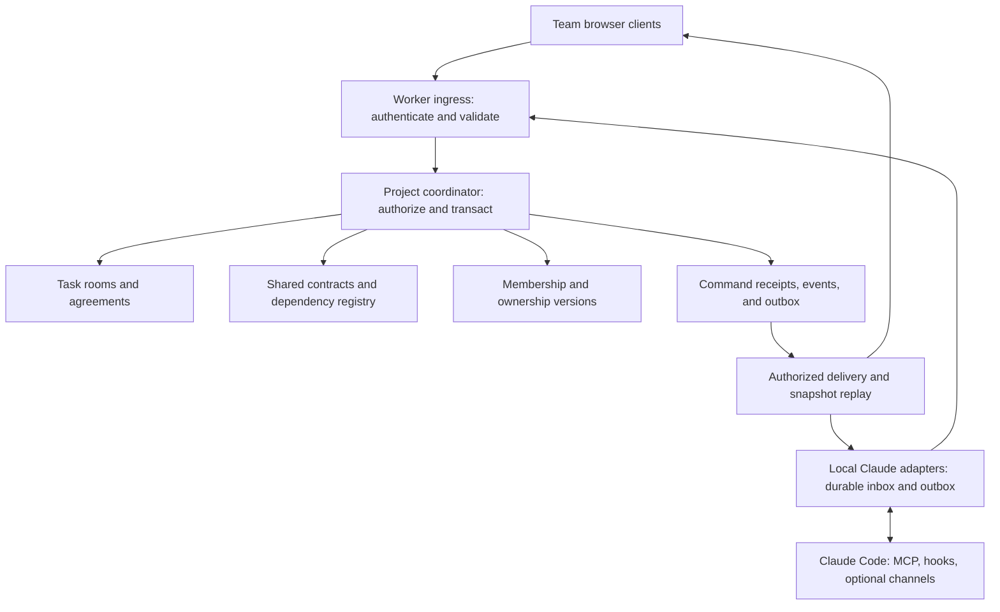

# Architecture stress test — project coordination and Claude Code

Date: 9 November 2026. Companion contract: ROOM_AGENT_CONTRACT.md v0.2.

## What was performed

An adversarial tabletop review of the proposed state model, including an independent Master Plan Architect review, a two-room failure trace, alternate event orderings, and a 64-scenario coverage matrix. No application was built or executed. No integration, load, security, chaos, restore, or model-behavior test has passed as a result of this exercise.

The matrix defines expected behavior and proof obligations. It is broad coverage of identified failure classes, not a claim that every possible scenario has been enumerated. Combinations, timing, client behavior, and actual implementation will create further cases.

## Architectural refinement accepted

One authoritative coordinator per project holds current membership/authority, rooms, shared contracts, declared dependencies, command outcomes, and event/outbox records. Cloudflare Worker ingress authenticates identity; the project coordinator authorizes each operation and performs bounded transactional updates in SQLite-backed Durable Object storage.

Every arrow represents a controlled interface, not guaranteed instantaneous delivery. Claude and its checkout remain external to the coordinator's transaction. Cloudflare documents asynchronous interleaving; a single coordinator alone does not eliminate races. Acceptance must use transactional checks and writes. Sources: [Durable Object design rules](https://developers.cloudflare.com/durable-objects/best-practices/rules-of-durable-objects/), [transactional SQLite storage](https://developers.cloudflare.com/durable-objects/api/sqlite-storage-api/).

## Findings that changed the contract

| Finding | Failure in the simpler design | v0.2 resolution |
|---|---|---|
| F01: room agreement vs shared target | Backend advances while frontend still appears aligned | Explicit pinned/target versions and per-room reconciliation obligations |
| F02: ownership has independent state | Former owner accepts against unchanged content version | Authority-version check in the acceptance transaction |
| F03: delivery vs uncertain external effects | Replay causes repeated work after a lost acknowledgement | State reconciliation and 'outcome unknown; inspect required' |
| F04: code identity is insufficient evidence | Old test stays green after the requirement changes | Evidence binds both artifact and specification versions |
| F05: restore revives old authority | Revoked members/commands reappear from backup | Quarantine, fresh recovery incarnation, current authority review, reattachment |
| F06: replay can leak data | Revoked member reads cached response or event history | Current authorization before cached responses and delivery |
| F07: deduplication expiration | Old offline command executes again after receipt deletion | Server-issued bounded command windows and retained outcome records |
| F08: context and connection differ | Healthy adapter masks forgotten or compacted context | Context generation plus explicit acknowledgement freshness |
| F09: one health badge is misleading | Connected agent is shown as compliant | Separate connection, synchronization, acknowledgement, plan, and evidence states |
| F10: unlimited project fan-out | Large shared change stalls or partially updates project | Bounded project operations and explicit rejection/backpressure |
| F11: lifecycle not defined | Archived room accepts retries or deletion recreates project | Versioned close/reopen, deletion tombstones, explicit creation |
| F12: service governs data, not arbitrary agent behavior | Question or accepted plan is mistaken for enforced execution | Separate routing/authority, local permissions, and advisory limits |

## Primary failure trace: two rooms and a disconnected agent

Illustrative setup: one project, backend room B and frontend room F. Both agreements reference price-units@1, integer cents. Each has a separate Claude run and owner. The contract has a designated human owner. Their exact actor names are illustrative.

| Step | Event | Required durable/UI result |
|---|---|---|
| 1 | Both agents acknowledge their agreement and price-units@1 | Record acknowledgement by run, context generation, and exact bundle |
| 2 | Frontend adapter loses connectivity while Claude continues local work | Show disconnected; preserve prior acknowledgement without claiming continued freshness |
| 3 | Backend agent proposes decimal amounts | Proposal only; no change to either authoritative agreement |
| 4 | Contract owner accepts @2 with declared scope and a migration approach | Atomically store @2 target, affected-room obligations, command result, and delivery intent |
| 5 | Acceptance response is lost | Browser shows uncertain outcome; queries the same command, not a new acceptance |
| 6 | Browser retries with the same ID and payload | Return authorized prior outcome; no @3 created |
| 7 | Backend task owner reconciles B's agreement to @2 | New B agreement; frontend remains pinned to @1 with reconciliation required |
| 8 | Backend adapter receives the new bundle twice | Persist/deduplicate receipt; no implicit claim Claude acted |
| 9 | Backend Claude acknowledges and implements part of the change | Report plan/application separately; rollout still pending |
| 10 | Frontend owner transfers responsibility while an old-owner acceptance is in flight | If acceptance commits first it stands; if transfer commits first old authority is rejected |
| 11 | Frontend reconnects with a local queued completion report and old versions | Reconcile current snapshot first; retain old report as historical, not current completion |
| 12 | Frontend uploads tests passing against @1 | Display historical success, current specification mismatch |
| 13 | New frontend owner accepts reconciliation to @2 | New agreement target; explicit fresh run/context acknowledgement needed |
| 14 | Frontend agent may already have partially changed code before losing an acknowledgement | Inspect checkout and existing effects; do not blindly re-execute a stale instruction |
| 15 | Both implementations submit evidence against current code and specification | Evaluate each criterion; record independent vs self-reported evidence distinctly |
| 16 | Deployment evidence is absent | Room can report implementation reviewed; cannot claim deployed API compatibility |

Result of the walkthrough: v0.1 could have misrepresented agreement freshness, authority, evidence, and replay safety. v0.2 defines responses to these cases. This is a logical review result, not an observed runtime result. A user could still merge incompatible changes outside the advisory platform.

## Scenario matrix

All rows are tabletop specifications. 'Expected' means required behavior when implemented. H01–H12 refer to hardening rules in the companion contract.

### A. Concurrent decisions and authority

| ID | Injected scenario | Expected response | Rule |
|---|---|---|---|
| A01 | Two acceptances use the same agreement base | At most one commits against that base; other reconciles | H01 |
| A02 | Ownership transfer races acceptance | Outcome follows atomic commit order and authority version | H03 |
| A03 | Owner removed while approval browser remains open | Current membership check denies stale approval | H01,H03 |
| A04 | Owner disappears permanently | Explicit audited administrator reassignment; no silent approval | H03 |
| A05 | Agent asks an owner-like question then attempts acceptance | Agent credential cannot call acceptance operation | H12 |
| A06 | Project's last administrator removes themselves | Require replacement or deliberate shutdown | H03 |
| A07 | Shared dependency changes while task acceptance waits | Validate dependency bundle at commit and reject stale request | H01,H02 |
| A08 | User accepts an already rejected/withdrawn proposal | Invalid transition rejected; intentional new proposal required | H01 |

### B. Shared contracts and dependency coverage

| ID | Injected scenario | Expected response | Rule |
|---|---|---|---|
| B01 | Contract accepted while a dependent run is offline | Persist reconciliation obligation immediately | H02 |
| B02 | Room pins old version after a new target is accepted | Show mismatch; no silent agreement rewrite | H02 |
| B03 | New room is created during shared-contract update | Transaction binds current target or explicit valid exception | H01,H02 |
| B04 | Unregistered consumer relies on an API | Disclose dependency coverage limitation; no 'all consumers safe' claim | H02 |
| B05 | Local constraint contradicts known shared contract | Reject structured conflicting override; flag ambiguous prose for review | H02,H12 |
| B06 | Breaking change accepted but rollout incomplete | Separate accepted target, adoption, and deployment evidence | H02,H08 |
| B07 | Temporary old-version exception expires | Mark reconciliation due; do not claim automatic process stop | H02 |
| B08 | Dependencies cycle or affected set exceeds project limit | Validate dependency graph rules; reject unbounded operation explicitly | H02,H10 |

### C. Message delivery and retry

| ID | Injected scenario | Expected response | Rule |
|---|---|---|---|
| C01 | Acceptance commits but HTTP response is lost | Query/retry stable command ID returns same authorized outcome | H04 |
| C02 | Duplicate ID arrives with different payload | Reject conflict; never reinterpret original command | H04 |
| C03 | Coordinator fails after commit and before broadcast | Durable outbox retains pending delivery | H05 |
| C04 | Outbox send succeeds but delivery marker is lost | Duplicate delivery possible; adapter deduplicates | H05 |
| C05 | Adapter receives event then crashes before persisting | Cursor does not advance; replay later | H05 |
| C06 | Old command retried after deduplication retention window | Reject expired window and require reconciliation | H04 |
| C07 | Messages arrive out of order or with a sequence gap | Apply contiguous/snapshot-consistent state; fetch gap before current status | H05,H06 |
| C08 | Network repeatedly reconnects with many pending clients | Backoff/jitter, bounded queues, visible pending status | H10 |

### D. Claude run, context, and checkout

| ID | Injected scenario | Expected response | Rule |
|---|---|---|---|
| D01 | Hook supplied context but Claude never processed it | Context-supplied observation only; no model acknowledgement | H07 |
| D02 | Claude session closes with queued direction | Pending/offline; no promise of wake-up | H05,H07 |
| D03 | Channel unavailable or protocol incompatible | Capability downgraded visibly; supported checkpoint path used | H07 |
| D04 | Context compacts after acknowledgement | Refresh context at supported checkpoint; re-ack generation | H07 |
| D05 | Same session switches branch or worktree | Update checkout identity; review freshness and evidence applicability | H07,H08 |
| D06 | Two adapters concurrently claim one run | New connection generation fences stale writes | H07 |
| D07 | Agent changes files before acknowledgment persistence | Mark uncertain outcome; inspect before resuming effects | H05 |
| D08 | Tool is running or local permission prompt blocks progress | Show actual known state; no claim remote direction interrupted it | H07,H12 |

### E. Security, access, and content

| ID | Injected scenario | Expected response | Rule |
|---|---|---|---|
| E01 | Token names a different project's room | Reject ownership/scope mismatch | H01,H12 |
| E02 | Revoked member retries an old successful command | Authorization fails before cached sensitive result returns | H04,H06 |
| E03 | Revoked socket remains physically connected | Stop new server release; invalidate subscription | H06 |
| E04 | Cursor copied across identities, scopes, or projects | Reject; cursor is never authority | H06 |
| E05 | Comment or source file tells Claude to override ownership | Preserve untrusted source; server authority unaffected; model risk disclosed | H12 |
| E06 | Rich text or evidence link contains executable markup | Escape/sanitize rendering and safe link handling | H12 |
| E07 | Evidence URL targets localhost, metadata service, or private endpoint | No arbitrary privileged fetching; controlled collector required | H12 |
| E08 | Secret appears in captured text or diagnostic log | Minimize/redact collection; purge and token rotation response if exposed | H12 |

### F. Evidence and completion

| ID | Injected scenario | Expected response | Rule |
|---|---|---|---|
| F01 | Agent says 'done' without evidence | Application reported; verification pending | H08 |
| F02 | Test passed on earlier commit | Historical pass does not verify current commit | H08 |
| F03 | Code unchanged but acceptance criterion changed | Evidence applicability becomes unresolved for new criterion | H08 |
| F04 | Contract changed while task requirements text stayed unchanged | Dependency-bound verification becomes stale | H08 |
| F05 | Test ran against dirty checkout | Require content identity or explicitly qualify result | H08 |
| F06 | Feature commit passes but merge result differs | Verify resulting artifact; no blanket inherited pass | H08 |
| F07 | Evidence link disappears or check is flaky/contradictory | Preserve provenance and uncertainty; no silent green result | H08 |
| F08 | Agent fabricates a CI claim or replaces verifier identity | Keep agent report distinct; trusted collector/reviewer identity required | H08,H12 |

### G. Recovery, migration, and data lifecycle

| ID | Injected scenario | Expected response | Rule |
|---|---|---|---|
| G01 | Restore predates member revocation | Quarantine; current authority reviewed before reopening | H09 |
| G02 | Restore predates external action but contains its pending request | No automatic effect replay; reconcile external state | H05,H09 |
| G03 | Old adapter reconnects after restore | Recovery-epoch mismatch; reattach and snapshot | H09 |
| G04 | Event history compacted beyond cursor | Snapshot at known boundary plus later events | H06 |
| G05 | Sensitive content purged but remains in replay/backup | Apply retention/redaction policy to each surface; disclose backup expiration | H06,H11 |
| G06 | Client/server protocol or database schema upgrades diverge | Compatibility check; reject unsupported writes and use tested migration recovery | H01,H09 |
| G07 | Room closes while late plan/change commands arrive | Reject new mutations; explicit reopen and reconcile | H11 |
| G08 | Deleted project receives offline retry | Tombstone/explicit creation rules prevent resurrection | H11 |

### H. Limits, operation, and usability failures

| ID | Injected scenario | Expected response | Rule |
|---|---|---|---|
| H01 | Free quota exhausted | Visible unavailable coordination; bounded local queue; no false sync | H10 |
| H02 | Local disk full or queue corrupted | Stop claiming durable receipt; show recovery-needed state | H05,H10 |
| H03 | One project floods event stream | Per-principal/project limits; preserve control-change priority | H10 |
| H04 | Oversized plan, recursive payload, or evidence metadata | Validate bounds before transactional work | H10,H12 |
| H05 | Outbox alarm/retry repeatedly fails | Persist pending work, alert operator, bound attempts and retry scheduling | H05,H10 |
| H06 | Heartbeat stays healthy while model is stuck | Separate connection health from execution/acknowledgement | H07 |
| H07 | Users never check a busy room | Attention inbox for unresolved ownership, questions, and reconciliation | H02,H03 |
| H08 | Reporting creates narration spam or excessive Claude turns | Structured milestone updates, bounded context, measured reporting overhead | H07,H10 |

## Pairwise and compound stress cases

The rows above must also be combined. Priority sequences:

1. Contract acceptance + offline frontend + ownership transfer + old-specification evidence: primary trace above.
2. Acceptance response loss + adapter effect + backup restore: reject the assumption that an unacknowledged effect never occurred.
3. Revocation + cached response + replay cursor: authorization must precede every read path, including optimizations.
4. Context compaction + duplicate channels delivery + branch switch: no inherited acknowledgement or evidence for the wrong context/artifact.
5. Quota exhaustion + local disk full + recovery: preserve explicit uncertainty; do not acknowledge durable storage that failed.
6. Schema upgrade + restored old outbox + deleted project: incompatible historical commands cannot revive a project or bypass new authority.
7. Shared-contract update + new dependency registration + large affected set: transaction and size checks avoid missing a newly registered consumer or partial acceptance.
8. Owner loss + malicious agent proposal + administrative reassignment: reassignment changes authority, not approval of the pending proposal.

## Additional decisions made explicit by this review

- A shared-contract change requires a declared compatibility approach before approval when it affects multiple consumers. The room tracks implementation/deployment evidence independently.
- Structured shared-contract IDs are authoritative. The backend cannot automatically prove arbitrary prose or code is semantically compatible; ambiguous contradictions require human review.
- Define dependencies as references, not an automatically executable job graph. Cycles may be valid references; detect and display them, avoid recursive fan-out, and reject cycles only where a future scheduling rule requires acyclicity.
- A room's initial human visibility inherits project membership; private-room permissions are deferred. Adapter scopes can still restrict operations and delivery to assigned rooms. All access paths must respect those scopes.
- Project administration recovers orphaned ownership explicitly. The first release does not need automatic escalation or a general policy engine.
- The local adapter is a trusted component with limited credentials; model messages cannot impersonate its authenticated identity. This does not make agent reports independently true.
- Validate the entire server-registered credential/project/connection/run/context/checkout binding, including every referenced record. Possessing one valid adapter credential does not authorize impersonating another run.
- Offline stale reports may be resubmitted by a currently authorized participant as historical observations with original provenance. This requires a valid current command window and cannot alter current completion, plan, or verification state.
- Show a compact attention inbox, dependency-impact preview, and 'what this run acknowledged' view. These directly expose correctness state and are more valuable than a large raw activity feed.

## What must be proven before claiming production readiness

### First real vertical slice

Demonstrate one project, two rooms, two Claude sessions, an actual accepted shared change, a real disconnection, a replay, explicit acknowledgement, and artifact-specific evidence. Use actual client behavior and make unsupported controls unavailable. Also test unauthorized acceptance, a stale owner, and duplicate command handling.

### Before external pilot

Run automated tests of every valid/invalid state transition and role boundary; integrate actual supported Claude versions; test offline queues, bounded hooks, conflict handling, rendering safety, and secret hygiene. Verify documented recovery of user-visible pending state. Track integration/version limitations in the UI.

### Before production claims

Execute the full relevant matrix and compound cases, load tests with explicit project limits, tenant/scope isolation tests, protocol migrations, credential revocation, retention/deletion, and quarantined restore with external state ahead of backup. Establish observability, service objectives, alerts, incident ownership, and restore objectives from measurements. Set actual command-window, retention, queue, payload, and rate limits before launch.

No test matrix can prove that an independent LLM always follows instructions. That remains a product boundary. The first platform's defensible guarantee is correct and attributable coordination state, with visible uncertainty about external execution.

## Scope and rollout recommendation

Keep atomic authorization/versioning, command receipts, durable delivery, reconnect reconciliation, scoped evidence, and honest status in the first usable slice. These are foundational correctness, not premium features.

Prototype the smallest shared-contract dependency flow needed for the two-room demonstration. Broader administrative recovery, retention automation, deployment collectors, scale tuning, and extensive compatibility support belong to the pilot/production gates above. Do not imply they already exist in a hackathon demonstration.

Free-tier availability does not establish a production capacity or reliability guarantee. Keep the architecture within available allowances and validate capacity before choosing a service commitment.

## Review conclusion

The project-level boundary is retained. The tabletop exposed twelve classes of missing rules and produced 64 scenario specifications plus eight compound sequences. The resulting architecture is more explicit and internally reviewable. Its production readiness is still unproven until the implementation passes the relevant tests.

A final independent consistency review corrected three ambiguities: idempotent replay is bounded by authorization/window/epoch/retained outcome; the full registered identity chain must be validated; and historical stale-report ingestion is separate from current-state mutation. Document checks confirmed 64 unique matrix IDs. These checks validate the document's structure, not software behavior.

File mutation manifest: [MODIFY] ROOM_AGENT_CONTRACT.md; [NEW] ARCHITECTURE_STRESS_TEST.md. Only Markdown planning documents were changed.

