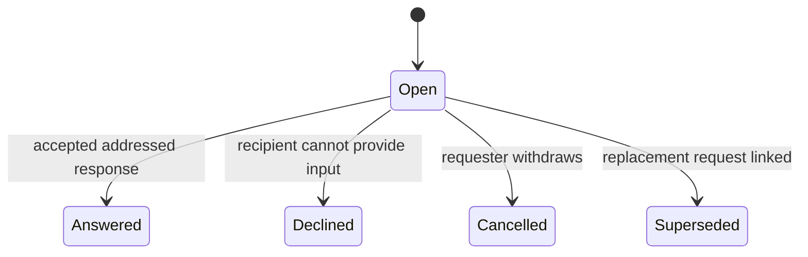

# Collaboration protocol

Proposed architecture contract v0.1 — 11 November 2026.

This refines MULTIPLAYER_COLLABORATION_MODEL.md and MULTIPLAYER_WALKTHROUGH.md. The identity, permission, idempotency, recovery and evidence rules in ROOM_AGENT_CONTRACT.md v0.2 apply to every operation. This is a design specification; no client, state machine or integration test has been executed.

## 1. Shared rules

Every mutation checks current project access, actor/run binding, command window, recovery epoch and expected record versions. Human acceptance also checks current ownership/authority versions. Persist the mutation and notification intent atomically; deliver asynchronously. A retry with the same identity and payload returns the retained result only within the existing idempotency rules.

The project coordinator orders accepted changes. Laptop timestamps and message arrival at an agent do not establish authority. A timed-out operation has an unknown outcome until reconciled; timeout is not rejection or permission to repeat an external effect.

Accepted scope, a run's plan, delivery observations, reported execution and collected verification remain distinct. Display these dimensions separately. Do not reduce them to one “synced” or “done” flag.

Routine collaboration within the accepted agreement does not require human approval. Only consequential changes use the existing task or shared-contract acceptance path. Local tool permissions remain independent.

## 2. Questions and addressed requests

A question contains a stable ID, originating work, author, intended responsible work/person, currently addressed run where applicable, relevant agreement/contract/artifact versions, question text, record version and resolution status. A due time can support attention routing; it does not authorize action.

| Operation | Who and preconditions | Result |
| --- | --- | --- |
| Ask | Authorized contributor or registered run; target within authorized project scope | Open question and durable delivery intent. |
| Contribute | Authorized participant | Attributed discussion or proposed answer; does not impersonate the recipient or automatically close the question. |
| Answer | Addressed person/run or explicitly recorded delegate; expected open question version and current routing generation | Answer linked to the question; status answered. This records a response, not agreement, implementation or satisfaction. |
| Decline | Addressed person/run; same current-routing checks | Reason recorded; dependent work remains unresolved. |
| Cancel | Requester or current originating task owner; expected open version | Cancelled with attribution and reason. Previously delivered context cannot be recalled. |
| Supersede/retarget | Requester or responsible task owner; current version | Old question superseded; linked replacement names the new recipient/context. No silent recipient mutation. |

Use a new linked follow-up if the response is inadequate; do not silently reopen terminal records. Replies racing cancellation or supersession must pass the expected-version check. The losing reply can be appended as attributed historical discussion under current authorization; it cannot change the terminal outcome.

Delivery observations—queued, adapter received, context supplied and agent acknowledged—are recorded independently per recipient run and context generation. They do not form the resolution state machine. Repeated delivery observations are deduplicated. A question can remain open after acknowledgement.

If relevant context changes before an answer arrives, preserve the answer's original scope and show it as requiring review for current use. It cannot resolve an outstanding question about a newer contract by implication. The consumer may ask a follow-up or reference it with an explicit explanation of applicability.

## 3. Handoffs and consumption

A handoff is an immutable publication identifying producer work/run, artifact location/type, revision or digest, applicable agreement/contracts, limitations and evidence references. A correction creates a new publication with a replacement link. A mutable URL alone does not establish artifact identity.

Track these separately:

- Publication: available, explicitly withdrawn, or accompanied by a newer replacement. History remains visible.
- Retrieval: not observed, successful with observed identity, or failed with reason.
- Consumption: a particular consumer run/plan declares its intent to use a particular revision, or records why it cannot.
- Verification: named checks against identified inputs and requirements, with source classification.

| Operation | Guard | Result |
| --- | --- | --- |
| Publish | Producer bound to relevant work; artifact identity and scope present | Immutable handoff and notifications for declared consumers. |
| Record retrieval | Authorized consumer/collector; identify observed content and source | Retrieval observation only; mismatch becomes a blocker. |
| Adopt | Current consumer run; expected consumer plan version; exact handoff and applicable accepted agreement versions | Plan references the selected input and an attributed adoption record. This does not claim retrieval, execution or correctness. |
| Report incompatibility | Authorized consumer run/person; exact handoff reference | Open blocker or addressed question; existing dependency is not silently replaced. |
| Replace/withdraw | Current responsible producer human or registered producer run acting within scope; expected publication metadata version | Explicit reason and notification. Preserve prior artifacts, adoption and evidence. |

Replacement availability alone does not invalidate a still-applicable older input. Withdrawal for a known defect creates a visible blocker for known consumers, but cannot stop already-running external processes. Fresh adoption of an already withdrawn handoff fails. Adoption racing withdrawal is serialized; if adoption wins first, subsequent withdrawal creates the consumer's attention item atomically with its notification intent.

A consumer may remain on an older compatible revision. Show whether its declared acceptance criteria still apply; never claim compatibility solely because no error was reported. Replacement runs declare their own adoption after context refresh.

## 4. Shared changes and reconciliation

Change requests retain the existing states: proposed, accepted, rejected, withdrawn, or superseded before acceptance. An accepted change is never rewritten into “not accepted”; reversal requires a new accepted revision.

On accepting a shared-contract change, atomically update the contract target and mark known dependent tasks as requiring reconciliation. A task's current pin remains unchanged. Dependency suggestions from agents do not establish complete impact coverage.

For each affected task, record target contract revision, current accepted pin and reconciliation status:

| Status/action | Meaning |
| --- | --- |
| Needs review | The task owner must assess the new target's effect. |
| Propose reconciliation | Agent or human proposes concrete task agreement/plan changes. |
| Owner accepts reconciliation | Check task, contract target and authority versions; update the task agreement and dependency pin atomically; create delivery intents. |
| Owner records blocker | Preserve the old pin and the reason; task is visibly unresolved against the target. |
| Run acknowledges | Record acknowledgement of the precise updated task/contract versions. |
| Run reports adaptation | Link implementation and evidence; independent verification remains separate. |

A task owner cannot reject the existence of an accepted shared target by keeping an older pin. They can identify incompatibility, propose a contract amendment or request that an authorized owner revise the dependency's applicability. A “not affected” statement needs an attributed applicability decision; it cannot silently remove a dependency.

If C3 replaces C2 during reconciliation, acceptance based on an expected C2 target fails as stale. Keep the C2 proposal as history and reassess against C3. If a person owns both contract and task, an explicitly described combined action may accept both atomically; it must check both authorities and versions.

First-release changes target one agreement or shared contract at a time. Related requests can be grouped for discussion, but partial acceptance must remain visible. Do not promise an atomic change spanning several independently owned contracts; such a workflow requires a separate design. Until all required decisions are accepted, the grouped proposal is unresolved.

A task reconciles only to a complete, permitted dependency bundle. Partial acceptance of a grouped proposal cannot establish adoption of that group. Human ownership transfer changes acceptance authority, not run identity or previous acknowledgements. Agent replacement changes run identity, not human ownership. Replacing a producing run does not by itself invalidate its published artifacts.

## 5. Joint verification and feature progress

Evidence identifies the resulting candidate or reproducible composition manifest, source artifact revisions, integration baseline and composition method, relevant agreement/contract versions, environment/check configuration, result and collector/source. An assembly conflict, infrastructure failure, failing test and passing test are different outcomes.

Evaluate freshness against actual recorded inputs. A code or requirement change creates an unverified new combination unless an explicit justified applicability decision supports reuse. Preserve historical results. Scope human review to the artifact and criterion actually reviewed.

Derive the room summary from named criteria and unresolved obligations: work underway, needs human input, evidence missing, or ready for review with its stated scope. A feature coordinator may record a human acceptance assessment with attribution; it does not approve another person's PR or authorize a merge.

## 6. Delivery, replacement and bounded autonomy

On reconnect, recheck access and run identity, refresh current authoritative context, then reconcile pending requests. Keep original request context visible. A replacement run receives a new identity and must acknowledge relevant versions; it does not inherit the old run's understanding. Retarget pending requests explicitly. Inspect uncertain prior effects before repeating them.

Limit agent exchanges by task/project message, token and time budgets. Deduplicate retries and identify repeated request/response loops. Escalation creates a concise attention item with the unresolved question and relevant evidence. It never invents an answer, changes ownership or approves scope.

The coordinator is authoritative for coordination state; external code execution cannot be rolled back by a message-state transition. Cancellation, withdrawal and revocation therefore describe coordination decisions and their delivery, not guaranteed interruption of a running agent.

## 7. Implementation-time acceptance scenarios

1. Offline recipient: request persists; no acknowledgement is fabricated; refresh precedes current-context use on reconnect.
2. Answer races cancellation: one versioned transition wins; late content cannot reverse it.
3. Handoff withdrawn during adoption: ordered result is visible and known consumers receive the defect/blocker notice.
4. Producer publishes B2: consumer remains on B1 until explicit adoption; no inherited evidence for B2.
5. C3 arrives during C2 reconciliation: stale acceptance fails; no partial update of task pin or delivery intent.
6. Owner/run changes: old authority cannot accept; replacement run cannot inherit acknowledgements; late old-run replies cannot satisfy retargeted requests.
7. Two contract changes accepted only in part: the grouped proposal is not shown as fully adopted.
8. Combined check passes, then an input changes: original result remains historical; new combination remains unverified.
9. Message retries and budget exhaustion: one logical effect per valid retained request; unresolved work reaches the attention view without a loop.

These are validation obligations, not claims that tests have passed. They supplement the existing architecture stress matrix.

